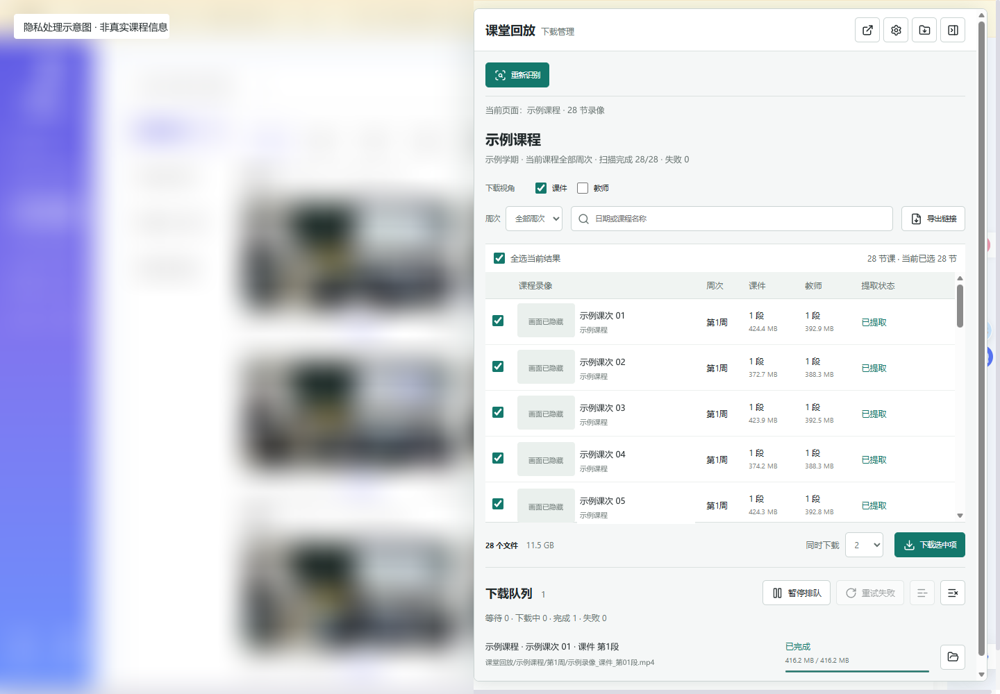
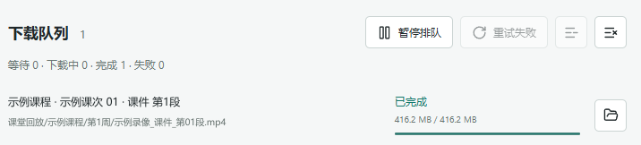

# 课堂回放下载

用于中国矿业大学云课堂的 Edge 扩展。在课堂页面右侧展开浮窗，即可选择课件或教师视角，批量下载课堂录像。

仅用于下载当前账户有权访问的录像，请遵守课程使用要求，未经许可不要传播。

## 安装与更新

### 首次安装

1. 下载本仓库并解压。
2. 在 Edge 地址栏输入 `edge://extensions`，打开“开发人员模式”。
3. 点击“加载解压缩的扩展”，选择解压后的插件文件夹。
4. 正常登录云课堂，进入“课堂实录”或视频播放页。

### 更新插件

1. 用新版文件更新原插件文件夹。
2. 在 `edge://extensions` 找到本插件，点击“重新加载”。
3. 刷新已打开的课堂页面。

## 开始下载

1. 在“课堂实录”左侧选择课程，等待录像列表加载。
2. 点击页面右侧的下载图标，展开浮窗。
3. 等待识别完成，确认浮窗中的课程名称。
4. 选择“课件”“教师”中的一种或两种，按周次或日期筛选并勾选录像。
5. 确认文件数量和总大小，点击“下载选中项”。

**下载整门课程，请在“课堂实录”列表页操作；在视频播放页打开浮窗，只识别当前这一节。**

下载和链接导出只处理当前筛选结果中已勾选的录像。

在课堂实录列表页展开浮窗后，可以确认当前课程、选择视角并勾选需要下载的录像：

以下图片已做隐私处理：课程、课次和文件名使用示例信息，课堂画面已隐藏。



## 选择下载视角

| 视角 | 内容 |
| --- | --- |
| 课件 | 课件、投屏等教学画面，默认选择 |
| 教师 | 教师摄像画面 |

可以只选一种，也可以同时下载两种。插件不下载学生视角。

一节录像有多个分段时，会分别保存。若某节课没有所选视角，会显示“无此视角”，不会用其他画面替代。

## 浮窗与课程切换

- 点击右侧下载图标展开浮窗；点击顶部“收起浮窗”或按 `Esc` 收起。
- 在课堂页面点击浏览器工具栏的插件图标，也可以展开或收起浮窗。
- 切换课程后，浮窗会自动更新。确认新课程名称及录像列表后再下载。
- 切换课程、收起浮窗或关闭管理页，都不会取消已提交的下载。
- 浮窗顶部的“打开独立管理页”按钮可打开单独的管理页面。

## 保存位置

视频保存在 **Edge 当前设置的下载目录**中，按课程和周次分类：

```text
下载目录/
  课堂回放/
    课程名称/
      第1周/
      第2周/
```

文件名包含上课日期、时间、视角及分段信息，方便查找。

可在下载队列中点击“在文件夹中显示”，直接定位已完成的视频。需要更改保存位置时，点击浮窗顶部的“Edge 下载设置”。

## 管理下载

| 操作 | 作用 |
| --- | --- |
| 同时下载 | 可选择同时下载 1–4 个文件，默认 2 个 |
| 暂停排队 | 暂不开始新文件，已经开始的下载继续进行 |
| 继续排队 | 继续下载等待中的文件 |
| 重试失败 | 重新尝试失败的视频，可能需要从头下载 |
| 移除等待中的任务 | 移除尚未开始的任务，不影响正在下载的文件 |
| 清除已完成记录 | 仅清除队列记录，不删除视频 |
| 导出链接 | 将选中录像的下载链接保存为文本文件 |

已有下载任务会自动跳过。需要再次下载已完成的视频时，先清除已完成记录。

下载期间请保持 Edge 运行。若要暂停或取消某个正在下载的文件，请打开“浏览器下载记录”操作。

下载队列会显示任务状态和进度；完成后，点击右侧的文件夹图标即可找到视频：



## 常见问题

### 页面右侧没有下载按钮

确认已启用插件，并进入“课堂实录”或视频播放页。安装或更新后，请刷新课堂页面。

### 录像未识别，或仍显示上一门课程

等待课堂页面加载完成，再点击“重新识别”。如果登录已过期，请重新登录后刷新页面。

### 为什么只显示一节录像？

当前打开的是视频播放页。返回“课堂实录”列表页，选择课程后即可批量下载。

### 下载失败怎么办？

检查网络连接和磁盘空间，再点击“重试失败”。如果 Edge 显示安全提示，请打开“浏览器下载记录”查看原因。

### 文件夹里有未完成的临时文件

先更新插件，再重试失败任务。对于旧版留下的临时文件，确认没有对应的进行中下载、同名视频已完整下载后，再单独清理；不要删除仍在下载的文件。

### 每个文件都要求选择保存位置

打开“Edge 下载设置”，按需要调整“下载前询问每个文件的保存位置”选项。
